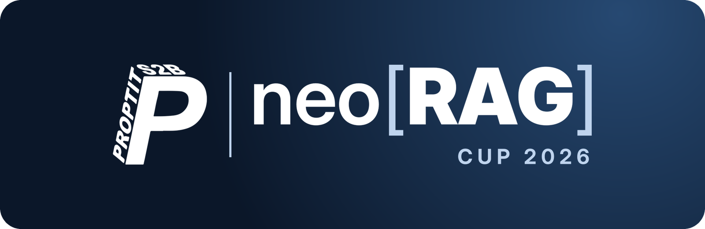

 

NeoRAG Cup 2026 là cuộc thi nội bộ do Team AI – CLB Lập Trình PTIT tổ chức. Thí sinh thiết kế và triển khai một hệ thống Retrieval-Augmented Generation (RAG) trả lời câu hỏi về cộng đồng S2B, gồm CLB Lập Trình PTIT (ProPTIT), CLB Multimedia PTIT (MPC) và CLB Nhà Sáng Tạo Game PTIT (GCC), sau đó trình bày sản phẩm trước Ban giám khảo.

Repository này cung cấp bộ dữ liệu, pipeline baseline, bộ chấm chính thức và một chatbot mẫu để tham khảo. Hướng dẫn cài đặt và sử dụng có trong tài liệu [Hướng dẫn sử dụng](docs/guide.md).

## Tổng quan

| Hạng mục | Chi tiết |
|---|---|
| Hình thức | Thi cá nhân |
| Đối tượng | Thành viên Team AI – CLB Lập Trình PTIT |
| Thời gian | 19/10/2026 – 09/11/2026 |
| Mô hình ngôn ngữ | `claude-haiku-5-5`, truy cập qua gateway của Ban tổ chức bằng key cá nhân |
| Hệ thống chấm | [aichallenge.ptit.edu.vn](https://aichallenge.ptit.edu.vn/) |
| Trang cuộc thi | [bit.ly/neorag2026](https://bit.ly/neorag2026) |

## Tài liệu

| Tài liệu | Nội dung |
|---|---|
| [Hướng dẫn sử dụng](docs/guide.md) | Cài đặt môi trường, cấu hình key, chạy baseline, xây dựng pipeline và tạo bài nộp |
| [Sử dụng gateway](docs/gateway.md) | Kết nối tới mô hình ngôn ngữ và embedding của cuộc thi, tra cứu ngân sách, giới hạn và mã lỗi |
| [Quy định](docs/rules.md) | Mô hình được phép sử dụng, key và ngân sách, các hành vi bị cấm, xử lý vi phạm |
| [Nộp bài](docs/submission.md) | Định dạng bài nộp, quy trình nộp Public Test và Private Test |
| [Nộp bài trên aichallenge](docs/aichallenge.md) | Tạo tài khoản, đăng ký cuộc thi, nộp bài, đọc kết quả và xử lý lỗi trên hệ thống chấm |
| [Đánh giá](docs/evaluation.md) | Định nghĩa các metric, công thức tính điểm và cách quy đổi theo baseline |
| [Dữ liệu](data/README.md) | Mô tả corpus, bộ câu hỏi, nguồn và mức độ xác minh |

## Lịch trình

| Giai đoạn | Thời gian | Nội dung |
|---|---|---|
| Khởi động | 19/10 – 25/10 | Công bố thể lệ, cấp repository và key cho thí sinh |
| Public Test | 26/10 – 07/11 | Nộp bài và theo dõi bảng xếp hạng công khai; tổ chức talkshow chia sẻ kinh nghiệm |
| Private Test | 08/11 | Đánh giá trên bộ câu hỏi mới; kết quả dùng để tính điểm Benchmark |
| Pitching | Thông báo sau | 20 phút trình bày và demo, 10 phút hỏi đáp với Ban giám khảo |

## Yêu cầu sản phẩm

Mỗi thí sinh hoàn thành các hạng mục sau:

1. Pipeline RAG hoàn chỉnh, từ xử lý dữ liệu, indexing, truy xuất đến sinh câu trả lời.
2. Bài nộp Public Test và Private Test trên hệ thống chấm.
3. Giao diện chatbot hỏi đáp thông tin các CLB, xây dựng bằng công nghệ tùy chọn.
4. Bài trình bày về kiến trúc, các quyết định kỹ thuật và kết quả đánh giá, kèm demo tại buổi pitching.

## Đánh giá

| Tiêu chí | Trọng số | Nội dung đánh giá |
|---|---:|---|
| Benchmark | 40% | Kết quả trên Private Test, chấm bằng bộ chấm chính thức |
| Pitching | 25% | Mức độ hiểu sản phẩm, khả năng giải thích các quyết định kỹ thuật, trình bày và trả lời câu hỏi |
| Technical | 20% | Kiến trúc hệ thống, quản lý mã nguồn với Git, chất lượng và cách tổ chức code |
| Demo Product | 15% | Giao diện, tốc độ phản hồi và trải nghiệm người dùng |

Điểm Benchmark đánh giá đồng thời chất lượng truy xuất và chất lượng câu trả lời, mỗi phần chiếm một nửa. Điểm trên bảng xếp hạng được quy đổi theo baseline của Ban tổ chức: bài nộp không vượt ngưỡng (điểm baseline cộng 1) nhận 0 điểm, bài nộp cao nhất nhận 100 điểm. Kết quả chung cuộc chỉ tính theo Private Test; Public Test dùng để thử nghiệm. Chi tiết xem tài liệu [Đánh giá](docs/evaluation.md).

## Giải thưởng

| Giải | Giá trị |
|---|---:|
| Giải Nhất | 200.000 VNĐ |
| Giải Nhì | 150.000 VNĐ |
| Giải Ba | 100.000 VNĐ |
| Giải Tiềm năng | 50.000 VNĐ |

Mỗi giải thưởng kèm giấy chứng nhận của Ban tổ chức.

## Liên hệ

Mọi thắc mắc về cuộc thi xin liên hệ Ban tổ chức.

| Người phụ trách | Email | Facebook |
|---|---|---|
| Hoàng Đỗ | [dekthedev.business@gmail.com](mailto:dekthedev.business@gmail.com) | [fb.com/dekthedev](http://fb.com/dekthedev) |

## Giấy phép

Mã nguồn được phát hành theo [giấy phép MIT](LICENSE). Bộ dữ liệu chỉ được sử dụng cho mục đích học tập trong khuôn khổ NeoRAG Cup 2026; bản quyền nội dung gốc thuộc về các CLB và các nguồn được ghi trong `data/sources.csv`.
